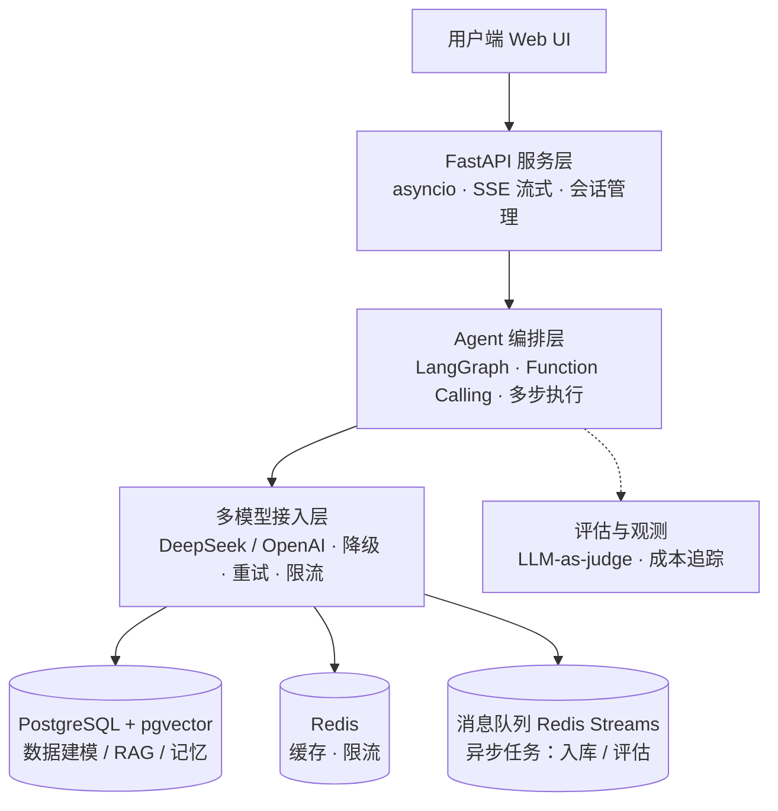

# AI Agent Workbench（多模型 Agent 对话工作台）

> 为投递「AI 应用开发工程师」岗位准备的作品集骨架：一个能跑起来、能逐层讲清设计决策的 Agent 应用。  
> 覆盖 JD 要求的：asyncio 异步 / 流式输出 / 多模型接入 / Agent 框架 / RAG / 关系型+向量库 / 消息队列 / 评估与成本。

---

## 一、架构与 JD 映射



| 项目模块                  | 对应 JD 要求                                       | 代码位置                                             |
| --------------------- | ---------------------------------------------- | ------------------------------------------------ |
| FastAPI + SSE 流式      | asyncio 异步、流式输出、流式一致性                          | `app/main.py`                                    |
| 会话状态管理                | 多轮会话状态管理                                       | `app/memory/manager.py`                          |
| Agent 编排层             | Agent 框架(LangGraph)、意图路由、Function Calling、多步执行 | `app/llm/agent.py`                               |
| 多模型接入层                | 多供应商接入、自动降级、重试、幂等、限流                           | `app/llm/providers.py` `app/tasks/rate_limit.py` |
| PostgreSQL + pgvector | 数据建模、RAG/向量检索                                  | `app/db.py` `app/rag/store.py`                   |
| Redis                 | 缓存设计、限流                                        | `app/tasks/rate_limit.py`                        |
| 消息队列                  | 异步任务、至少一次投递                                    | `app/tasks/queue.py` `app/tasks/worker.py`       |
| 评估模块                  | LLM-as-judge 评测体系（加分）                          | `app/eval/judge.py`                              |
| 成本追踪                  | Token 成本优化与可观测（加分）                             | `app/eval/cost.py`                               |

---

## 二、快速开始

### 方式 A：Docker 一键起（推荐，最贴近面试演示）

```bash
cp .env.example .env          # 填入至少一个 LLM API Key
docker compose up --build     # 启动 postgres + redis + api
```

启动后访问 `http://localhost:8000/health` 验证，`http://localhost:8000/docs` 看接口。

### 方式 B：本地开发

```bash
python -m venv .venv && source .venv/bin/activate
pip install -r requirements.txt

# 需要本地 PostgreSQL(pgvector) 与 Redis，或用 docker compose 只起这两个：
docker compose up -d postgres redis

cp .env.example .env          # POSTGRES_DSN / REDIS_URL 用 localhost 版本
uvicorn app.main:app --reload --port 8000
```

### 方式 C：真实中文 RAG（推荐演示用）

默认 `embedding_provider=fake` 是零依赖伪向量，仅跑通结构。**要演示真·中文检索**，二选一：

- **轻量（推荐，无需 torch）**：在 `.env` 设 `embedding_provider=openai` 并填 `OPENAI_API_KEY`，用 OpenAI embeddings（中文能力足够）。
- **本地最佳**：设 `embedding_provider=bge`，并取消 `requirements.txt` 里 `sentence-transformers` 的注释（中文效果最好，但需下载模型权重）。

然后切块入库演示文档、验证召回：

```bash
# 切换向量维度后先清表（仅首次或换 provider 时需要）
python scripts/reset_db.py
# 切块入库电商退款政策演示文档
python scripts/seed_demo.py
# 直接看 RAG 召回了哪些片段
curl -X POST http://localhost:8000/search \
  -H "Content-Type: application/json" \
  -d '{"query":"质量问题退货的运费谁承担"}'
```

> 切换 `embedding_provider` 后向量维度会变，**必须**先 `reset_db.py` 再 `seed_demo.py`，否则维度不匹配会报错。

### 方式 D：跑评测集（LLM-as-judge 打分）

知识库准备好后，用 `data/eval/refund_qa.json` 里的 7 条业务问答评估 Agent 表现，结果写入 `eval_runs` 表并打印平均分：

```bash
python scripts/run_eval.py
# 查看累计真实 token 成本
curl http://localhost:8000/metrics
```

`/metrics` 现在记录的是模型 `usage` 的真实 token 数（不再是字符数估算）。

### 跑通一条最小链路（无 API Key 也能验证结构）

即使不填 Key，也可以先验证 DB / RAG 链路（用伪向量）：

1. `POST /documents` 上传几条文档
2. `POST /eval` 用空 dataset 触发（会直接用主模型，无 Key 时跳到报错提示）

---

## 三、API 速览

| 方法   | 路径                 | 说明                                |
| ---- | ------------------ | --------------------------------- |
| GET  | `/health`          | 健康检查 + LLM 就绪状态                   |
| POST | `/chat/stream`     | SSE 流式对话（`{"session","message"}`） |
| POST | `/documents`       | 同步上传文档（RAG 入库）                    |
| POST | `/documents/async` | 异步入队（worker 消费）                   |
| POST | `/eval`            | 触发 LLM-as-judge 评估                |
| GET  | `/metrics`         | Token/成本累计指标                      |

示例（SSE 对话）：

```bash
curl -N -X POST http://localhost:8000/chat/stream \
  -H "Content-Type: application/json" \
  -d '{"session":"demo","message":"帮我总结一下知识库里关于退款政策的内容"}'
```

启动后台 Worker（异步任务消费）：

```bash
python -m app.tasks.worker
```

---

## 四、面试「讲点」清单（建议补完）

1. **朴素 RAG 为什么会翻车**（重点，已可在本项目展开）：
   - 切块：固定字数硬切会截断条款/句子，本项目用 `app/rag/chunk.py` 按段落+句切分并带重叠；
   - Embedding：chromadb 默认 all-MiniLM 对中文无效，本项目可切到 OpenAI embeddings / 本地 BGE；
   - 检索：召回噪声、无出处，本项目 `rag_search` 工具返回带 `[出处]` 的片段便于引用。
2. **多模型接入层**：为什么要把 DeepSeek/OpenAI 统一成一层？降级和限流的触发条件怎么定？
3. **流式一致性**：SSE 中途断流、客户端重连时如何保证幂等、不重复生成。
4. **成本可观测**：Token 估算 → 接入真实 usage → 缓存常见问答降低花费。
5. **长期记忆**：当前是消息落库，可演进为「会话摘要压缩 + 用户画像」。

---

## 五、待填的「肉」（按优先级）

- [x] 真实中文 RAG：`embedding_provider` 已支持 openai/bge，演示文档与一键入库脚本已就绪
- [x] 前端 UI：极简聊天页，挂在 `GET /`（同源），对话 + 知识库检索调试
- [x] 跨供应商运行时 failover：上游异常自动切下一个供应商重试（见 `app/llm/agent.py`）
- [x] 真实 Token 计量：LangChain callback 取模型 `usage`，替代 `len//4` 估算（`app/llm/usage.py` + `app/eval/cost.py`）
- [x] 评测集：7 条退款政策业务问答已就绪（`data/eval/refund_qa.json`），一键 `python scripts/run_eval.py` 跑分
